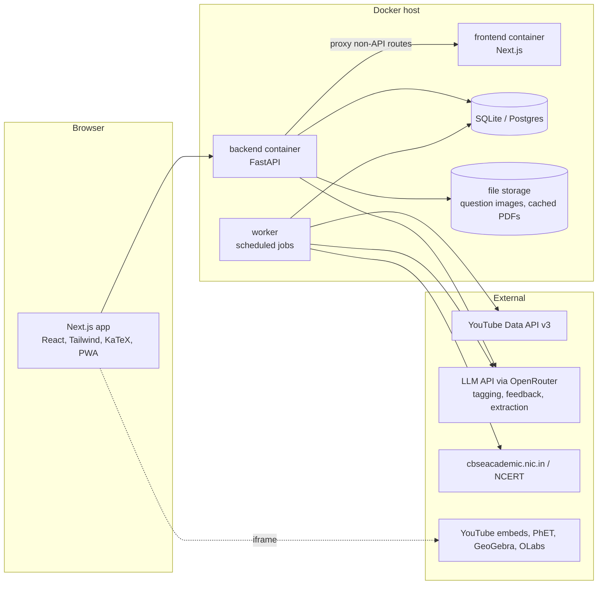

# CBSE Class 10 Study Platform - Technical Plan and Architecture

## 1. Goals

A private website for one Class 10 CBSE student (and a parent as curator) that:

1. Collects the best free videos and tutorials for every chapter and topic, so concepts are learnt with examples and real-life applications.
2. Gives hands-on practice: topic quizzes, chapter tests, CBSE sample papers, previous year questions (PYQs), and simulations/virtual labs.
3. Tracks progress per topic so weak areas are visible and revision is targeted.
4. Is safe and distraction-free: only parent-approved content, no open YouTube browsing, no comments, no ads injected by the site.

Non-goals for v1: multi-school SaaS, payments, live classes, a mobile app (the site is responsive and can be installed as a PWA).

## 2. Users and Roles

| Role | Can do |
|------|--------|
| Student | Browse study materials, watch videos, take quizzes/tests, see own progress, make notes, bookmark |
| Parent (admin) | Everything above, plus approve/reject curated content, add resources and questions, view progress reports |

## 3. Site Structure (Sections)

```
Home / Dashboard
  - Today's plan, continue where you left off, weak topics, upcoming revision

Study Materials
  Subject -> Chapter -> Topic
    - Concept videos (ranked, 1-3 "best" picks + alternates)
    - Worked examples videos
    - Real-life applications (short videos, articles)
    - Interactive: simulations (PhET), GeoGebra applets, OLabs virtual labs
    - NCERT textbook chapter (link), NCERT Exemplar (link)
    - Notes: summary, formula/key-term sheet, mind map (parent or AI-drafted, parent-approved)
    - "Check yourself" mini-quiz (5 questions)

Practice
  - Topic quizzes (auto-graded MCQ, assertion-reason, numeric)
  - Chapter tests (mixed, timed)
  - NCERT in-text + exercise questions with solutions
  - Previous Year Questions (filter by year, chapter, marks)
  - CBSE Sample Papers + marking schemes (official)
  - Full mock exam mode (3 hours, CBSE section pattern, self-check against marking scheme)
  - Mistake notebook (every wrong answer saved for re-attempt)

Revision
  - Flashcards with spaced repetition (definitions, formulas, dates, reactions)
  - Formula and key-points sheets per chapter (printable)

Progress
  - Mastery per subject/chapter/topic, time spent, test history, streaks
  - Weekly report for parent

Admin (parent only)
  - Curation queue (approve/reject suggested videos)
  - Add/edit resources, questions, sample papers
  - Syllabus manager
```

### Subjects and syllabus (Class 10, CBSE)

- Mathematics (Standard / Basic - choose per student)
- Science (Physics, Chemistry, Biology chapters)
- Social Science (History, Geography, Political Science, Economics)
- English Language and Literature (First Flight, Footprints Without Feet, grammar, writing)
- Hindi (Course A or B) or other second language

The chapter list is seeded from the current CBSE curriculum document published on cbseacademic.nic.in (it changes almost every year - rationalised chapters must be re-checked each April). The syllabus is stored as data, not hard-coded, so it can be updated from the admin screen.

## 4. Content Sources

Only free and legitimate sources. Videos are embedded (YouTube allows embedding), PDFs are linked to the official site; we do not re-host copyrighted material.

| Type | Sources |
|------|---------|
| Textbooks | NCERT (ncert.nic.in/textbook.php), NCERT Exemplar |
| Official papers | CBSE Academic - sample question papers and marking schemes; CBSE previous year papers |
| Government e-content | DIKSHA (NCERT-aligned, energised textbooks via QR codes), ePathshala, NROER |
| Concept videos | YouTube channels with strong CBSE Class 10 coverage, e.g. Khan Academy India, Magnet Brains, LearnoHub, Physics Wallah Foundation, Vedantu 9&10, Infinity Learn, Dear Sir (Maths), plus others discovered by the ranking pipeline |
| Concept depth / applications | Khan Academy (khanacademy.org), CrashCourse, TED-Ed, Veritasium-style explainers for real-world context |
| Interactive / hands-on | PhET simulations (University of Colorado), GeoGebra, Desmos, OLabs (Amrita / CDAC virtual labs built for CBSE practicals) |

## 5. Video Curation and Ranking ("highly rated")

YouTube no longer exposes dislike counts, so "highly rated" is computed from signals we can get, then confirmed by the parent.

### Pipeline

1. **Query generation** - for each topic, build queries such as `"<topic> class 10 CBSE"`, `"<topic> class 10 NCERT explained"`, `"<topic> real life applications"`.
2. **Search** - YouTube Data API v3 `search.list` (type=video, relevanceLanguage=en/hi, videoEmbeddable=true, safeSearch=strict).
3. **Enrich** - `videos.list` (statistics, contentDetails, status) and `channels.list` (subscriber count) in batches of 50.
4. **Score**:
   ```
   engagement = (likes + 2*comments) / max(views, 1)
   score = 0.35 * norm(log(views))
         + 0.25 * norm(engagement)
         + 0.15 * norm(log(channel_subscribers))
         + 0.15 * trusted_channel_bonus          # whitelist of known-good channels
         + 0.10 * duration_fit                   # 6-25 min ideal for concept videos
         - penalty(age > 6 years, shorts, non-embeddable, "live" streams > 2h)
   ```
5. **Relevance check (optional, AI-assisted)** - fetch title/description (and transcript when available) and ask an LLM: "Does this video teach <topic> at Class 10 CBSE level? Tag: concept / worked-examples / application / revision." Low-relevance results are dropped.
6. **Curation queue** - top 5-8 per topic go to the parent's queue. Parent approves, marks one as "Best pick", or rejects. Only approved items are visible to the student.
7. **Feedback loop** - the student can rate a video (helpful / not helpful) and the watch-completion rate is recorded; both feed back into ordering.

### Quota

The YouTube API gives 10,000 units/day. `search.list` costs 100 units, `videos.list`/`channels.list` cost 1. About 90 searches/day is enough: the full syllabus (~250 topics x 2-3 queries) is covered in about a week of nightly runs, then refreshed monthly. All results are cached in the database.

## 6. Practice Engine

### Question bank

Every question is tagged with subject, chapter, topic, type, marks, difficulty, source (NCERT / Exemplar / PYQ-year / sample paper / custom) and competency-based flag.

Question types aligned to the CBSE paper format:

| Type | Marks | Grading |
|------|-------|---------|
| MCQ, Assertion-Reason | 1 | Auto |
| Numeric / fill-in | 1-2 | Auto (tolerance for numeric) |
| Very short / short answer | 2-3 | Self-check against model answer + marking scheme; optional AI feedback |
| Long answer | 5 | Self-check; optional AI feedback |
| Case / source-based (sub-parts) | 4 | Mix of auto and self-check |

The paper blueprint (sections A-E, marks per section, internal choice) is stored as a config per subject and year so it can be updated when CBSE changes the pattern.

### Building the bank

- NCERT exercise questions and Exemplar: entered via the admin screen or bulk CSV/JSON import.
- PYQs and sample papers: PDF downloaded from the official source, text extracted (pdfplumber/PyMuPDF), split into questions with LLM assistance, then reviewed by the parent before publishing. Math is stored as LaTeX and rendered with KaTeX; diagrams are stored as cropped images.
- AI-generated practice questions (optional): generated per topic, always marked "AI-generated" and only published after parent review.

### Test modes

- **Topic quiz** - 5-10 questions, instant feedback with explanation and a link back to the relevant video timestamp.
- **Chapter test** - 20-30 minutes, mixed types, result breakdown by topic.
- **Mock exam** - full blueprint, 3-hour timer, answers typed or written on paper; after submission the student self-grades using the official marking scheme (scores are recorded per question).
- **Mistake re-attempt** - questions answered wrongly reappear after 1, 3 and 7 days.

### Mastery model

Kept simple:

```
topic_mastery = weighted average of the last 10 attempts on that topic,
                recent attempts weighted higher, harder questions weighted higher
```

Bands: Not started / Learning (<50%) / Practising (50-80%) / Mastered (>80%). The dashboard suggests the next action: watch video, retry quiz, or move on.

Flashcards use the SM-2 spaced-repetition algorithm (the same idea as Anki).

## 7. Architecture

This repository already uses Next.js + FastAPI + SQLite + Docker. The study platform reuses the same stack so tooling, scripts and deployment patterns carry over.



### Components

| Component | Technology | Responsibility |
|-----------|-----------|----------------|
| Frontend | Next.js (App Router), React, Tailwind, KaTeX, react-markdown | Pages, video player (YouTube IFrame API for progress tracking), quiz UI, dashboards |
| Backend API | FastAPI, Pydantic, SQLAlchemy 2 / SQLModel | Auth, content, question bank, attempts, progress, admin |
| Worker | Same Python codebase, APScheduler (in-process) or a cron container | Nightly video discovery, monthly refresh, PDF ingestion, re-ranking |
| Database | SQLite (single family) - switch to Postgres if more users are added | All structured data |
| File storage | Local volume (`data/files`); S3/R2 later if hosted | Question diagrams, cached official PDFs for offline use |
| Search | SQLite FTS5 (or Postgres full-text) | Search topics, questions, notes |
| AI | LLM via OpenRouter (already configured in this repo) | Relevance tagging, question extraction, optional answer feedback, notes drafts |

### Data model (core tables)

```
users(id, name, role[student|parent], password_hash, created_at)

subjects(id, name, code, variant)                 -- e.g. Maths Standard
chapters(id, subject_id, number, title, syllabus_year, is_active)
topics(id, chapter_id, order, title, learning_objectives)

resources(id, topic_id, type[video|article|simulation|pdf|notes],
          title, url, provider, channel_name, duration_sec,
          language, purpose[concept|examples|application|revision],
          score, status[suggested|approved|rejected], is_best_pick,
          metadata_json, created_at)

resource_progress(user_id, resource_id, watched_sec, completed, rating, last_seen_at)

questions(id, topic_id, chapter_id, type, marks, difficulty,
          source, source_ref, is_competency_based,
          body_md, options_json, answer_json, explanation_md,
          marking_scheme_md, image_path, status[draft|published])

tests(id, user_id, kind[quiz|chapter|mock|retry], subject_id,
      blueprint_json, started_at, submitted_at, time_limit_sec)
attempts(id, test_id, question_id, response_json, score, max_score,
         graded_by[auto|self|ai], time_spent_sec)

papers(id, subject_id, year, kind[sample|pyq], url, local_path, marking_scheme_url)

mastery(user_id, topic_id, value, updated_at)
flashcards(id, topic_id, front_md, back_md)
flashcard_reviews(user_id, card_id, ease, interval_days, due_at)
notes(id, user_id, topic_id, body_md, updated_at)
bookmarks(user_id, item_type, item_id)
```

### API (REST, JSON)

```
POST /api/auth/login | /api/auth/logout | GET /api/auth/me

GET  /api/subjects
GET  /api/subjects/{id}/chapters
GET  /api/chapters/{id}                 -- topics + progress
GET  /api/topics/{id}                   -- approved resources, notes, mini-quiz

POST /api/resources/{id}/progress       -- watch time, completion, rating

POST /api/tests                         -- {kind, scope, blueprint} -> generated test
GET  /api/tests/{id}
POST /api/tests/{id}/answers            -- save answer (autosave)
POST /api/tests/{id}/submit             -- auto-grade objective parts
POST /api/attempts/{id}/self-grade      -- marks for subjective answers
POST /api/attempts/{id}/ai-feedback     -- optional

GET  /api/papers?subject=&kind=&year=
GET  /api/progress/summary | /api/progress/topics?subject=
GET  /api/flashcards/due | POST /api/flashcards/{id}/review
GET  /api/mistakes

-- parent only
GET  /api/admin/curation-queue
POST /api/admin/resources/{id}/approve | /reject | /best-pick
POST /api/admin/questions (single, bulk import)
POST /api/admin/jobs/discover?topic_id=  -- run discovery now
PUT  /api/admin/syllabus
GET  /api/admin/reports/weekly
```

### Frontend routes

```
/login
/                                  dashboard
/study                             subjects grid
/study/[subject]                   chapters with mastery bars
/study/[subject]/[chapter]         topics list
/study/[subject]/[chapter]/[topic] videos, simulations, notes, mini-quiz
/practice                          choose quiz / chapter test / mock / PYQ / sample paper
/practice/test/[id]                test runner
/practice/test/[id]/result         breakdown + review
/papers                            sample papers and PYQs library
/revision/flashcards
/mistakes
/progress
/admin/...                         curation queue, resources, questions, syllabus, reports
```

## 8. Key Implementation Details

- **Video embedding**: use `youtube-nocookie.com` embeds with `rel=0`, `modestbranding=1`; the YouTube IFrame API reports play time so completion can be tracked. The student never lands on youtube.com (no recommendations rabbit hole).
- **Math and science notation**: Markdown + LaTeX rendered with KaTeX on both question bodies and notes; chemical equations via the `mhchem` KaTeX extension.
- **Offline / low bandwidth**: PWA with service worker caching of notes, flashcards and downloaded PDFs; videos require internet.
- **Accessibility and comfort**: dark mode, large fonts option, keyboard navigation in the test runner.
- **Hindi support**: UI strings in English; content can be Hindi or English and is tagged with `language`.
- **AI usage boundaries**: AI output is never shown to the student without parent approval, except per-answer feedback, which is labelled "AI feedback - check with the marking scheme".

## 9. Security and Privacy

- Two accounts only; passwords hashed with argon2; session cookie (HttpOnly, SameSite=Lax, Secure in production).
- Parent-only routes enforced on the backend by role.
- API keys (YouTube, OpenRouter) kept in `.env`, never sent to the browser.
- No third-party analytics; no personal data leaves the server except prompts sent to the LLM (which contain no personal details).
- Content Security Policy that only allows iframes from the approved providers.

## 10. Deployment

- **Local / home**: `docker compose up` on a home PC, same as the existing project (`scripts/start.sh`).
- **Hosted** (to use from school or a phone): a small VPS (2 vCPU, 2-4 GB RAM) or Fly.io/Render with a persistent volume, Caddy for automatic HTTPS, nightly SQLite backup (Litestream to object storage or a simple cron copy).
- **Cost**: hosting about Rs 400-800/month for a small VPS (free if run at home); YouTube API free; LLM usage is small and can use a free or low-cost model.

## 11. Testing

- Backend: pytest for scoring formula, test generation against blueprints, grading, mastery and SM-2 calculations, role checks.
- Frontend: Vitest for components (quiz runner, timers), Playwright for key flows (login -> watch video -> take quiz -> see progress; parent approves a video and it appears for the student).
- Content checks: a script that verifies every active topic has at least one approved concept video and five published questions, and that all external links still resolve.

## 12. Roadmap

| Phase | Duration | Scope |
|-------|----------|-------|
| 1. Foundation | 1-2 weeks | Auth with roles, syllabus seed (all subjects/chapters/topics), study pages with manually added resources, YouTube embed + progress tracking |
| 2. Curation pipeline | 1-2 weeks | YouTube discovery + scoring worker, curation queue, best picks, student ratings |
| 3. Practice v1 | 2 weeks | Question bank, admin entry + CSV import, topic quizzes and chapter tests with auto-grading, mistake notebook |
| 4. Papers and mocks | 2 weeks | Sample papers/PYQ library, PDF ingestion with review, blueprint-based mock exams, self-grading with marking schemes |
| 5. Progress and revision | 1-2 weeks | Mastery model, dashboard, weekly parent report, flashcards with SM-2, formula sheets |
| 6. Polish | 1 week | PWA/offline, AI feedback on written answers, simulations/virtual labs mapped to topics, hosting + backups |

A usable version (phases 1-3) is achievable in about 4-6 weeks of part-time work; it is worth starting with Maths and Science, which benefit most from videos and practice, and adding other subjects afterwards.

## 13. Risks and Mitigations

| Risk | Mitigation |
|------|-----------|
| Syllabus or paper pattern changes yearly | Syllabus and blueprints stored as editable data with a `syllabus_year` |
| Popular videos that are off-syllabus or too advanced | LLM relevance check + mandatory parent approval |
| Videos get deleted or made private | Monthly link check marks them broken and promotes the next best alternate |
| Copyright | Embed and link only; official PDFs linked to source, cached copies for personal offline use only |
| Self-grading inflates scores | Show marking-scheme points to tick off; parent can review mock-exam answers |
| Screen-time / distraction | No external recommendations, optional daily study-time goal and break reminders |
