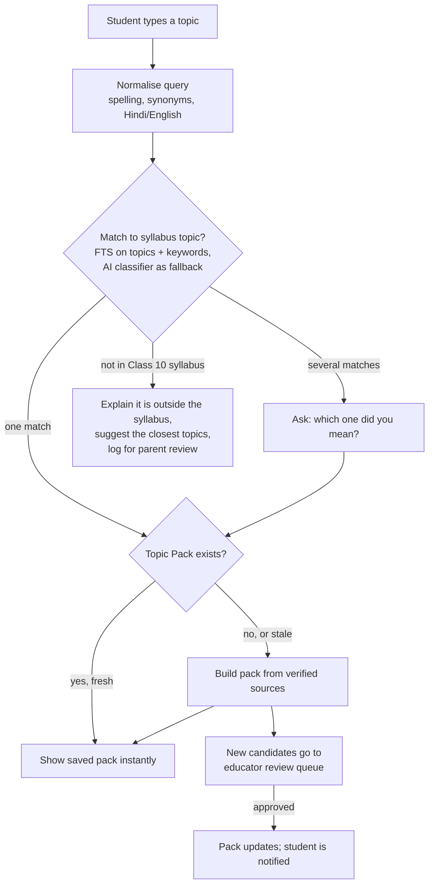
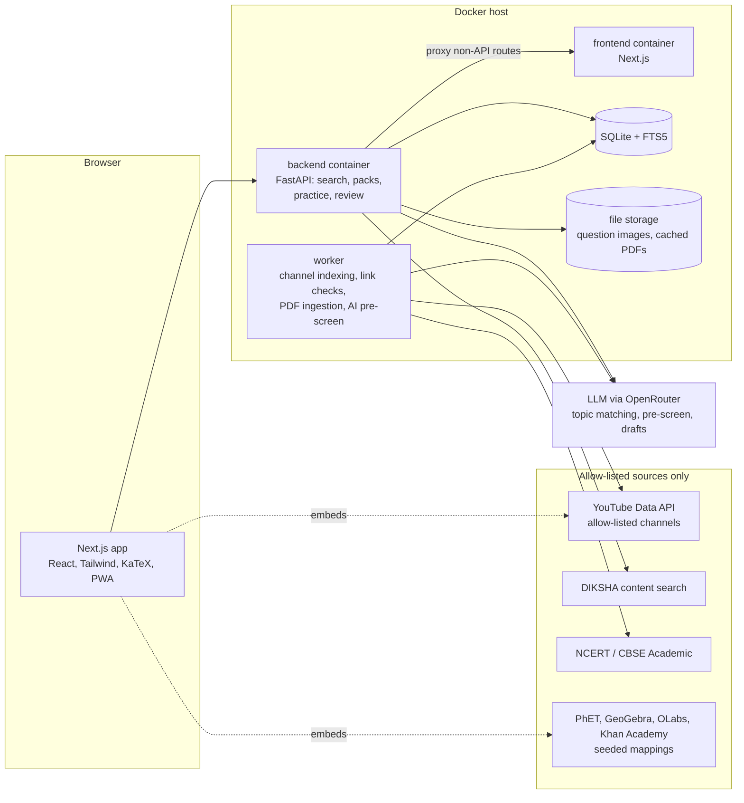

# CBSE Class 10 Study Platform - Technical Plan and Architecture

## 1. Goals

A private website for one Class 10 CBSE student, with a parent and one or more educators as reviewers, that:

1. Lets the student type any topic she wants to study. The site finds material for it, arranges it into the site's structure (study materials + practice), and saves the result in her library for later.
2. Shows only material that is **valid, verified and recommended by educators**. Nothing from the open web reaches the student without passing through a vetted source or an educator review.
3. Prioritises concept-clearing videos and tutorials with examples and real-life applications, followed by hands-on practice: quizzes, chapter tests, CBSE sample papers, previous year questions (PYQs), simulations and virtual labs.
4. Tracks progress per topic so weak areas are visible and revision is targeted.
5. Is distraction-free: no open YouTube browsing, no comments, no ads injected by the site.

Non-goals for v1: multi-school SaaS, payments, live classes, a native mobile app (the site is responsive and installable as a PWA).

## 2. Users and Roles

| Role | Can do |
|------|--------|
| Student | Search topics, use study materials, take quizzes/tests, see own progress, make notes, bookmark |
| Educator (reviewer) | Review and rate pending items, add recommendations, approve/reject channels and questions. Typically a school teacher or tutor invited by the parent |
| Parent (admin) | Everything an educator can do, plus manage users, view search history and progress reports |

The parent can act as reviewer, but the "recommended by educators" requirement is best met by inviting at least one subject teacher or tutor. Their names appear on the items they verify.

## 3. Site Structure (Sections)

```
Home / Dashboard
  - "What do you want to study today?" search box (primary entry point)
  - Continue where you left off, weak topics, revision due today

Search results -> Topic Pack (the unit of saved material, see section 5)
  Topic header: subject, chapter, NCERT reference, verification summary
  Tabs:
    Learn       concept videos (best pick + alternates), worked examples,
                real-life applications
    Explore     simulations (PhET), GeoGebra, OLabs virtual labs
    Read        NCERT chapter section, NCERT Exemplar, DIKSHA resources,
                summary notes and formula/key-term sheet
    Practice    5-question check, NCERT exercise questions, PYQs and
                sample-paper questions on this topic, start a topic quiz
    My notes    student's own notes and bookmarks for this topic

My Library
  - Every Topic Pack she has opened, grouped Subject -> Chapter -> Topic
  - Filter by subject, sort by recent / most visited / mastery
  - Packs update automatically when educators verify new material

Study Materials (browse instead of search)
  Subject -> Chapter -> Topic, using the same Topic Pack pages

Practice
  - Topic quizzes, chapter tests (timed)
  - Previous Year Questions (filter by year, chapter, marks)
  - CBSE Sample Papers + marking schemes
  - Full mock exam (3 hours, CBSE section pattern, self-check against marking scheme)
  - Mistake notebook (wrong answers come back for re-attempt)

Revision
  - Flashcards with spaced repetition
  - Printable formula and key-point sheets per chapter

Progress
  - Mastery per subject/chapter/topic, time spent, test history
  - Weekly report for the parent

Review (educator + parent)
  - Pending items queue, channel allow-list, question review, search history
```

### Subjects and syllabus

Mathematics (Standard/Basic), Science, Social Science (History, Geography, Political Science, Economics), English (First Flight, Footprints Without Feet, grammar, writing), Hindi (Course A/B).

The chapter and topic list is seeded from the current CBSE curriculum document on cbseacademic.nic.in and the NCERT textbooks. It changes almost every year, so it is stored as data with a `syllabus_year` and edited from the Review area, never hard-coded. Each topic also gets a list of keywords and synonyms (e.g. "Ohm's law", "V = IR", "resistance") so that free-text searches map onto it.

## 4. Verification Model

Every resource carries a **trust tier**, and the student sees only tiers 1-3.

| Tier | Meaning | Examples | Visible to student |
|------|---------|----------|--------------------|
| 1. Official | Published by the curriculum/exam authority | NCERT textbooks and Exemplar, CBSE sample papers, marking schemes, PYQs, NCERT/CIET official YouTube channels | Immediately |
| 2. Institution-reviewed | Created or reviewed by an educational institution with its own review process | DIKSHA (content reviewed through NCERT/SCERT workflows), Khan Academy, PhET (research-tested simulations), OLabs (Amrita/CDAC virtual labs for CBSE), GeoGebra materials from the official GeoGebra book collection | Immediately |
| 3. Educator-verified | A named educator on this site reviewed and approved this specific item | Any video from an allow-listed channel after review; AI-drafted notes or questions after review | After review |
| 4. Candidate | Found from an allow-listed source but not yet reviewed | New videos from allow-listed channels | No. Sits in the review queue |
| - | Anything else | Random web pages, non-allow-listed channels | Never ingested |

Rules:

- **Allow-listed sources only.** Search never runs against the open web. The system only queries or indexes sources in the `sources` registry, and each registry entry records who approved it and when.
- **Per-item review for YouTube.** A channel being allow-listed makes its videos *candidates*; individual videos still need an educator approval to become tier 3. This keeps a good channel's off-syllabus or outdated videos out.
- **Review rubric** (1-5 each): syllabus alignment, factual accuracy, clarity, examples/applications, age-appropriateness. An approval needs every criterion at 3 or above. The reviewer's name and an optional one-line recommendation ("Best explanation of refraction through a glass slab") are shown on the card.
- **AI is an assistant, not a verifier.** AI can pre-screen candidates (relevance to the syllabus, level, purpose tagging) and draft notes or questions, but nothing AI-produced becomes visible without an educator approval.
- **Re-verification.** Links are health-checked weekly. Items whose source changes (video removed, PDF moved) are hidden automatically, and the next-best verified alternate is promoted. Items are flagged for re-review when the syllabus year changes.
- **Student feedback.** "Helpful / Not helpful / Something is wrong" on every item. A "something is wrong" report hides the item for the student and sends it back to review.

### Allowed sites and third-party sign-in

- Links can only be added from an allow-list of sites (NCERT, CBSE, DIKSHA, SWAYAM, Khan Academy, PhET, GeoGebra, Desmos, OLabs, TED-Ed, YouTube, Udemy, Coursera, edX, BYJU'S, Vedantu, Unacademy, Physics Wallah). A parent can add more.
- Links are always shown once verified, even when a site needs an account. Cards from such sites show the site's note (e.g. "many courses are paid") and a "Sign in to <site>" link. A "Learning sites" page lists every site with its sign-in page.
- The student signs in on the site itself in a new tab; the browser keeps that session. Study Hub never asks for, proxies or stores third-party passwords.

### Content safety

- Allow-listed sources plus educator review (with an age-appropriateness score) are the main safeguard.
- YouTube videos that are age-restricted, not embeddable, or whose title/description contains a blocked term are never indexed or accepted, from any channel.
- Searches with blocked terms return nothing and are flagged to the parent. The blocked-terms list deliberately excludes syllabus vocabulary (reproduction, sex determination, "naked eye"), and a test checks that no syllabus topic is blocked.
- Content-Security-Policy restricts embeds to the YouTube privacy-mode player; everything else opens in a new tab.
- External sites are outside the platform's control, so device-level parental controls and a family DNS filter are recommended alongside it.

Each card in the UI shows a badge: `NCERT`, `CBSE Official`, `DIKSHA`, `Khan Academy`, `PhET`, or `Verified by <educator name>`.

## 5. Topic Search and Topic Packs

### Flow



### Why topic mapping matters

Every search is anchored to a syllabus topic. This keeps results on-syllabus, lets saved material appear both in "My Library" and in the regular Subject -> Chapter -> Topic structure, connects the material to practice questions and progress tracking, and lets two different phrasings ("photosynthesis", "how plants make food") reuse the same saved pack.

Matching steps:
1. Full-text search (SQLite FTS5) over topic titles, keywords and learning objectives.
2. If the top score is low or ambiguous, an LLM is given the query plus the candidate topic list and must return topic ids from that list only (it cannot invent topics).
3. Several plausible matches give the student a "Did you mean" choice. No match gives a polite out-of-syllabus message and logs the query, so the parent can add a topic if it is genuinely needed.

### Building a pack

When a topic has no pack yet (or the pack is older than the refresh interval, default 60 days), the backend gathers material in parallel from source adapters:

| Adapter | How it searches | Result tier |
|---------|-----------------|-------------|
| NCERT | Seeded mapping topic -> textbook chapter PDF + page range, Exemplar chapter | 1 |
| CBSE papers | Local question bank filtered by topic (sample papers, marking schemes, PYQs already ingested and reviewed) | 1 |
| Official YouTube (NCERT, CIET-NCERT, PM eVidya) | Local index (see below) | 1 |
| DIKSHA | DIKSHA/Sunbird public content search (board=CBSE, grade=Class 10, subject, keywords). Confirm access terms before going live; fall back to seeded links if unavailable | 2 |
| Khan Academy | Seeded mapping to the Khan Academy India NCERT Class 10 course units (no public API, so mapped once per chapter) | 2 |
| PhET / GeoGebra / OLabs | Seeded mapping topic -> simulation/lab (around 40-60 entries cover Class 10 Science and Maths) | 2 |
| Allow-listed YouTube channels | Local index, then per-video educator review | 4 -> 3 |
| Question bank | Published questions for this topic | 1 or 3 |

The material is assembled into the pack's tabs:
- **Learn**: up to 3 concept videos, 2 worked-example videos and 2 application videos. Ranked by tier first, then educator rating, then engagement score, then the student's own feedback.
- **Explore**: simulations and labs.
- **Read**: NCERT section, Exemplar, DIKSHA items, approved notes.
- **Practice**: question counts by type, plus "Start 5-question check".

The pack is saved, so the next visit loads instantly from the database with no external calls.

### Local video index (cheap, fast, restricted to vetted channels)

The site does not call YouTube search for each student query. Instead:
1. A nightly job reads each allow-listed channel's uploads playlist (`playlistItems.list`, 1 quota unit per 50 videos) and stores title, description, duration, publish date and stats (`videos.list`, 1 unit per 50).
2. Titles and descriptions are indexed in FTS5 and tagged to syllabus topics (keyword match, then an LLM tagging pass that picks from the topic list).
3. A student search queries this local index, which is instant and costs no quota. Matching videos that are not yet reviewed become candidates in the review queue for that topic.

About 20-30 channels with a few thousand videos each fit comfortably within the free 10,000 units/day quota. Even a nightly full refresh uses under 2,000 units.

### Engagement score (used only to order verified items and to prioritise the review queue)

```
engagement = (likes + 2*comments) / max(views, 1)
score = 0.40 * norm(log(views))
      + 0.30 * norm(engagement)
      + 0.15 * duration_fit          # 6-25 min ideal for concept videos
      + 0.15 * recency               # penalise > 6 years old
```

Popularity never makes an item visible on its own; it only orders items that are already verified.

### Making review fast enough

Educator time is the bottleneck, so the queue is designed around it:
- Candidates are grouped by topic and sorted by how many times students searched that topic, then by engagement score.
- The AI pre-screen fills in the summary, detected topic, level and purpose, and suggests a verdict. The educator confirms or overrides in a few clicks.
- The queue shows at most 5 candidates per topic, and stops proposing more once a topic has enough verified items.
- A weekly email digest is sent to educators with the topics the student searched that still have gaps.

Until a video is verified, the pack still shows tier 1-2 material (NCERT, DIKSHA, Khan Academy, simulations), and NCERT and Khan Academy alone cover every Class 10 topic. The student is never left with an empty page.

## 6. Practice Engine

### Question bank

Each question is tagged with subject, chapter, topic(s), type, marks, difficulty, source (NCERT / Exemplar / PYQ-year / sample-paper-year / educator / AI-drafted), tier and a competency-based flag.

| Type | Marks | Grading |
|------|-------|---------|
| MCQ, Assertion-Reason | 1 | Auto |
| Numeric / fill-in | 1-2 | Auto (tolerance for numeric) |
| Very short / short answer | 2-3 | Self-check against model answer + marking scheme; optional AI feedback |
| Long answer | 5 | Self-check; optional AI feedback |
| Case / source-based (sub-parts) | 4 | Mix of auto and self-check |

The paper blueprint (sections, marks per section, internal choice) is stored per subject and year, taken from the current CBSE sample paper.

### Where questions come from (all verified)

- **Official (tier 1)**: NCERT exercises, Exemplar, CBSE sample papers and PYQs. PDFs are downloaded from the official site and text is extracted (PyMuPDF). The AI splits the text into questions and tags their topics, then an educator checks the split before publishing. Answers come from the official marking schemes where they exist.
- **Educator-written (tier 3)**: entered in the Review area or imported in bulk from CSV/JSON.
- **AI-drafted (tier 4 -> 3)**: generated for topics with too few questions and published only after educator review. Labelled as "Practice question, reviewed by <name>".

Math is stored as LaTeX and rendered with KaTeX (chemistry with `mhchem`). Diagrams are stored as cropped images.

### Test modes

- **Topic check** (from a Topic Pack): 5 questions, instant feedback with explanation, and a link back to the relevant video timestamp or NCERT page.
- **Chapter test**: 20-30 minutes, mixed types, result broken down by topic.
- **Mock exam**: full blueprint, 3-hour timer. After submission the student self-grades using the official marking scheme, and an educator can review the self-grading.
- **Mistake re-attempt**: wrong answers reappear after 1, 3 and 7 days.

### Mastery

```
topic_mastery = weighted average of the last 10 attempts on the topic
                (recent and harder questions weighted higher)
```

Bands: Not started / Learning (<50%) / Practising (50-80%) / Mastered (>80%). Each Topic Pack and Library entry shows the band and suggests the next step. Flashcards use the SM-2 spaced-repetition algorithm.

## 7. Architecture

The stack matches this repository (Next.js + FastAPI + SQLite + Docker), so tooling, scripts and deployment carry over.



### Components

| Component | Technology | Responsibility |
|-----------|-----------|----------------|
| Frontend | Next.js (App Router), React, Tailwind, KaTeX, react-markdown | Search box, Topic Pack pages, library, test runner, dashboards, review screens |
| Backend API | FastAPI, Pydantic, SQLAlchemy 2 | Auth/roles, topic matching, pack building, question bank, attempts, progress, review workflow |
| Source adapters | Python modules, one per source, sharing a `search(topic) -> list[ResourceCandidate]` interface | Isolate each source; a new vetted source is one new adapter plus a registry entry |
| Worker | Same codebase, APScheduler | Nightly channel indexing and tagging, weekly link checks, PDF ingestion, AI pre-screen of candidates, review digest emails |
| Database | SQLite with FTS5 (move to Postgres only if more users are added) | All structured data and full-text indexes |
| File storage | Local volume `data/files` | Question diagrams, cached official PDFs for offline use |
| AI | LLM via OpenRouter (already configured in this repo) | Constrained topic matching, candidate pre-screen, draft notes/questions, optional answer feedback |

### Data model (core tables)

```
users(id, name, role[student|educator|parent], email, password_hash, created_at)

subjects(id, name, code, variant)
chapters(id, subject_id, number, title, syllabus_year, ncert_ref, is_active)
topics(id, chapter_id, order, title, keywords, learning_objectives)
topics_fts                                   -- FTS5 over title, keywords, objectives

sources(id, name, kind[ncert|cbse|diksha|khan|phet|geogebra|olabs|youtube_channel],
        base_url, external_id, tier, approved_by, approved_at, is_active, notes)

resources(id, source_id, external_id, type[video|pdf|simulation|lab|article|notes],
          title, url, duration_sec, language, published_at, stats_json,
          engagement_score, tier, status[candidate|verified|rejected|hidden|broken],
          last_checked_at, created_at)
resource_topics(resource_id, topic_id, purpose[concept|examples|application|revision],
                start_sec, confidence, tagged_by[keyword|ai|educator])
resources_fts                                -- FTS5 over title, description

reviews(id, resource_id | question_id, reviewer_id, alignment, accuracy, clarity,
        examples, age_fit, verdict[approve|reject], recommendation, created_at)
ai_prescreens(id, resource_id, summary, suggested_topic_ids, level, purpose,
              suggested_verdict, model, created_at)

searches(id, user_id, query, matched_topic_id, outcome[pack|choose|out_of_syllabus],
         created_at)
topic_packs(id, topic_id, built_at, refreshed_at, layout_json)   -- ordered resource ids per tab
library_entries(user_id, topic_id, first_opened_at, last_opened_at, open_count, pinned)

resource_feedback(user_id, resource_id, helpful, problem_report, created_at)
resource_progress(user_id, resource_id, watched_sec, completed, last_seen_at)

questions(id, chapter_id, type, marks, difficulty, source, source_ref, tier,
          is_competency_based, body_md, options_json, answer_json, explanation_md,
          marking_scheme_md, image_path, status[draft|published|rejected])
question_topics(question_id, topic_id)
papers(id, subject_id, year, kind[sample|pyq], url, local_path, marking_scheme_url)
blueprints(id, subject_id, year, sections_json)

tests(id, user_id, kind[check|quiz|chapter|mock|retry], scope_json,
      started_at, submitted_at, time_limit_sec)
attempts(id, test_id, question_id, response_json, score, max_score,
         graded_by[auto|self|ai|educator], time_spent_sec)

mastery(user_id, topic_id, value, updated_at)
flashcards(id, topic_id, front_md, back_md, tier)
flashcard_reviews(user_id, card_id, ease, interval_days, due_at)
notes(id, user_id, topic_id, body_md, updated_at)
bookmarks(user_id, resource_id)
```

Visibility for the student is enforced in one place, a backend query helper that always filters to `status = 'verified'` or to sources with tier 1-2. Frontend code never decides what is safe to show.

### API (REST, JSON)

```
POST /api/auth/login | /api/auth/logout | GET /api/auth/me

GET  /api/search?q=                     -- {matches:[topic], pack_id?, outcome}
GET  /api/topics/{id}/pack              -- builds on first request, cached afterwards
POST /api/topics/{id}/pack/refresh      -- parent/educator only

GET  /api/library                       -- student's saved topics with mastery
PATCH /api/library/{topic_id}           -- pin/unpin

GET  /api/subjects | /api/subjects/{id}/chapters | /api/chapters/{id}

POST /api/resources/{id}/progress
POST /api/resources/{id}/feedback       -- helpful / problem report

POST /api/tests                         -- {kind, scope} -> generated test
GET  /api/tests/{id}
POST /api/tests/{id}/answers
POST /api/tests/{id}/submit
POST /api/attempts/{id}/self-grade
POST /api/attempts/{id}/ai-feedback

GET  /api/papers?subject=&kind=&year=
GET  /api/progress/summary | /api/progress/topics?subject=
GET  /api/flashcards/due | POST /api/flashcards/{id}/review
GET  /api/mistakes

-- educator / parent
GET  /api/review/queue?topic=           -- candidates with AI pre-screen
POST /api/review/resources/{id}         -- rubric scores + verdict + recommendation
POST /api/review/questions/{id}
GET  /api/review/sources | POST /api/review/sources | PATCH /api/review/sources/{id}
POST /api/review/questions/import
PUT  /api/review/syllabus
GET  /api/review/searches               -- search history, out-of-syllabus queries
GET  /api/reports/weekly
```

### Frontend routes

```
/login
/                                   dashboard with search box
/search?q=                          matches / did-you-mean / out-of-syllabus
/topic/[topicId]                    Topic Pack (tabs: learn, explore, read, practice, notes)
/library                            saved topics
/study, /study/[subject], /study/[subject]/[chapter]   browse structure
/practice, /practice/test/[id], /practice/test/[id]/result
/papers
/revision/flashcards
/mistakes
/progress
/review, /review/sources, /review/questions, /review/searches, /review/syllabus
```

The Topic Pack page has one canonical URL per topic (`/topic/[topicId]`), so searching, browsing and the library all lead to the same saved page.

## 8. Key Implementation Details

- **Video embedding**: `youtube-nocookie.com` embeds with `rel=0`. The YouTube IFrame API reports watch progress and can start at a tagged timestamp. The student never lands on youtube.com.
- **Pack freshness**: packs are rebuilt lazily when opened after the refresh interval, and incrementally whenever an educator verifies an item for that topic. The student's library entry stays the same; only the contents improve.
- **Offline**: PWA service worker caches the library list, notes, flashcards and downloaded official PDFs. Videos need internet.
- **Hindi/English**: content tagged with `language`; the student can set a preferred language, which orders results.
- **Notifications**: in-app badge (and optional email to the parent) when a pack the student saved gains newly verified material.

## 9. Security and Privacy

- Accounts for student, parent and invited educators only. Passwords hashed with argon2; HttpOnly, SameSite=Lax, Secure session cookies.
- Role checks on every review/admin endpoint in the backend.
- API keys (YouTube, OpenRouter) are kept in `.env` and never sent to the browser.
- The student's search queries are logged for the parent only. LLM prompts contain the query and topic list, never personal details.
- A Content Security Policy restricts iframes to the allow-listed embed domains (youtube-nocookie.com, phet.colorado.edu, geogebra.org, olabs.edu.in, khanacademy.org).

## 10. Deployment

- **Home**: `docker compose up` on a home PC, as with the existing project (`scripts/start.sh`).
- **Hosted** (for use from a phone or school): small VPS (2 vCPU, 2-4 GB RAM) or Fly.io/Render with a persistent volume, Caddy for HTTPS, nightly SQLite backup (Litestream or a cron copy to object storage).
- **Cost**: roughly Rs 400-800/month for a small VPS (free at home). The YouTube API is free within quota, and LLM usage is low (pre-screening and topic matching only).

## 11. Testing

- Backend (pytest):
  - topic matching (synonyms, ambiguity, out-of-syllabus)
  - the LLM matcher only returns ids from the list
  - the visibility helper never returns candidate/rejected/hidden items to a student (most important test)
  - pack assembly and ranking
  - review rubric thresholds
  - test generation against blueprints, grading, mastery and SM-2 calculations
  - role enforcement
- Frontend: Vitest for the search box, pack tabs and test runner. Playwright end-to-end flows:
  1. Student searches "Ohm's law", sees a pack with only NCERT/Khan/PhET material, and the topic appears in the library.
  2. An educator approves a candidate video, and it appears in the student's pack.
  3. The student reports a problem with a video, and it disappears and returns to the queue.
- Content checks: a weekly script verifies that every active topic has at least one verified concept resource and five published questions, and that all links resolve.

## 12. Roadmap

| Phase | Duration | Scope |
|-------|----------|-------|
| 1. Foundation | 1-2 weeks | Auth with three roles, syllabus seed with keywords, source registry, tier 1-2 seeded mappings (NCERT, Khan Academy, PhET, OLabs), browse pages |
| 2. Search and library | 1-2 weeks | Topic matching (FTS + constrained LLM), Topic Pack builder, `/topic/[id]` page, My Library, search history |
| 3. Verification workflow | 1-2 weeks | YouTube channel indexing, candidate queue, AI pre-screen, rubric review UI, badges, student feedback/reporting, link checker |
| 4. Practice v1 | 2 weeks | Question bank, CSV import, topic checks and chapter tests, mistake notebook |
| 5. Papers and mocks | 2 weeks | Sample papers/PYQs ingestion with educator check, blueprint mock exams, self-grading with marking schemes |
| 6. Progress and polish | 1-2 weeks | Mastery, dashboard, weekly report, flashcards, DIKSHA adapter, PWA/offline, hosting and backups |

Phases 1-3 give a usable search-and-learn site (about 4-6 weeks part-time). Start with Science and Maths.

## 13. Risks and Mitigations

| Risk | Mitigation |
|------|-----------|
| Unverified or wrong material reaches the student | Allow-list-only sources, tier model, a single backend visibility helper with tests, problem reports that hide items immediately |
| Educator review becomes a bottleneck | Tier 1-2 sources fill every pack from day one; AI pre-screen; queue prioritised by what the student actually searched; cap of 5 candidates per topic |
| Searches outside the syllabus or too vague | Topic mapping with "did you mean" and out-of-syllabus messages; logged for the parent |
| Syllabus or paper pattern changes yearly | Syllabus, keywords and blueprints stored as data with `syllabus_year`; items re-flagged for review on change |
| A DIKSHA endpoint changes or is restricted | Adapter isolation and seeded fallback links; the site works without it |
| Videos removed or made private | Weekly link check hides them and promotes the next verified alternate |
| Copyright | Embed and link only. Official PDFs are linked to their source; cached copies are kept for personal offline use only |
